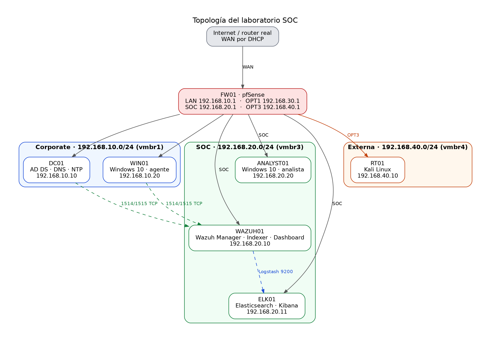
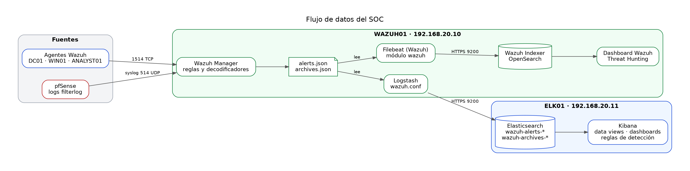

# Laboratorio SOC con Wazuh, Elastic Stack, pfSense, Active Directory y Kali Linux

Este documento describe cómo levantar un laboratorio de centro de operaciones de seguridad (SOC) con virtualización en Proxmox. Incluye la topología, la configuración de cada equipo, las integraciones entre herramientas, las reglas de detección y el plan de pruebas desde Kali Linux.

Las contraseñas aparecen como marcadores (`CONTRASEÑA_ELASTIC`, `CONTRASEÑA_ADMIN`, etc.). Guárdalas en un gestor de contraseñas y nunca en el chat ni en capturas.

---

## 1. Objetivo

Construir un entorno que simule una empresa con su red corporativa, un atacante externo y un centro de monitoreo, de forma que:

- Los eventos de los equipos Windows (inicios de sesión, cambios en el dominio) lleguen a Wazuh.
- Los bloqueos y permisos del firewall pfSense queden registrados y consultables.
- Las alertas se vean en dos plataformas: el dashboard de Wazuh y Kibana (Elastic Stack).
- El equipo de pruebas Kali Linux pueda generar actividad que el SOC detecte.

---

## 2. Arquitectura



**Flujos clave**

- Los agentes de Windows envían eventos al manager Wazuh por TCP 1514 (datos) y 1515 (registro).
- pfSense envía sus registros de firewall por syslog UDP 514 al manager Wazuh.
- Wazuh guarda las alertas y los archivos completos. Logstash los envía a Elastic (ELK01).
- El indexer de Wazuh recibe las alertas con su propio Filebeat, que instala el asistente.
- Kali solo llega a la red corporativa. No tiene acceso a la red SOC.

**Flujo de datos**



---

## 3. Plan de direccionamiento

| Interfaz pfSense | Bridge | Red | IP del firewall | Equipos |
|---|---|---|---|---|
| vtnet0 (WAN) | vmbr0 | Router real | DHCP | Ninguno |
| vtnet1 (LAN) | vmbr1 | Corporate 192.168.10.0/24 | 192.168.10.1 | DC01, WIN01 |
| vtnet2 (OPT1) | vmbr2 | Red Team 192.168.30.0/24 | 192.168.30.1 | Sin equipos |
| vtnet3 (OPT2) | vmbr3 | SOC 192.168.20.0/24 | 192.168.20.1 | WAZUH01, ELK01, ANALYST01 |
| vtnet4 (OPT3) | vmbr4 | Externa 192.168.40.0/24 | 192.168.40.1 | RT01 |

| VMID | Nombre | Función | Red | IP | DNS | vCPU | RAM | Disco |
|---|---|---|---|---|---|---|---|---|
| 100 | FW01 | pfSense CE | Todas | Según interfaz | - | 2 | 8 GB | 20 GB |
| 101 | DC01 | AD DS, DNS, NTP | vmbr1 | 192.168.10.10 | 127.0.0.1 | 4 | 32 GB | 80 GB |
| 103 | WIN01 | Windows 10 Pro | vmbr1 | 192.168.10.20 | 192.168.10.10 | 2 | 16 GB | 50 GB |
| 105 | RT01 | Kali Linux | vmbr4 | 192.168.40.10 | 1.1.1.1 | 4 | 16 GB | 60 GB |
| 106 | WAZUH01 | Wazuh Server | vmbr3 | 192.168.20.10 | 192.168.20.1 | 4 | 32 GB | 100 GB |
| 107 | ELK01 | Elasticsearch, Kibana | vmbr3 | 192.168.20.11 | 192.168.20.1 | 6 | 32 GB | 150 GB |
| 108 | ANALYST01 | Windows 10 Pro | vmbr3 | 192.168.20.20 | 192.168.10.10 | 2 | 8 GB | 40 GB |

**Dominio:** `lab.local` (NetBIOS `LAB`).

**Recursos del host:** 256 GB de RAM. Las VMs suman unos 152 GB, así que queda margen. Desactiva el ballooning en las VMs de Wazuh, Elastic y Windows.

---

## 4. Preparación en Proxmox

1. Crea los bridges `vmbr0` a `vmbr4` en el nodo antes de las VMs.
2. Asigna a pfSense cinco interfaces de red, una a cada bridge, en el orden `vtnet0` a `vtnet4`.
3. Para cada VM, en **Hardware > Memory**, desactiva el ballooning.
4. Instala cada sistema con su IP estática. Expande el volumen LVM si el instalador deja espacio libre:

```bash
sudo lvextend -l +100%FREE /dev/ubuntu-vg/ubuntu-lv
sudo resize2fs /dev/ubuntu-vg/ubuntu-lv
df -h /
```

5. Toma una snapshot de cada VM cuando esté funcionando, para tener puntos de restauración.

---

## 5. pfSense (FW01)

### 5.1 Asignar interfaces y direcciones

En **Interfaces > Assignments** asigna `vtnet1` a LAN, `vtnet2` a OPT1, `vtnet3` a OPT2 (SOC) y `vtnet4` a OPT3. Para cada interfaz OPT, en **Interfaces > [nombre]**, activa la interfaz, configura IPv4 estático y pon la IP con máscara /24 indicada en la tabla.

### 5.2 Acceso al panel web

En **System > Advanced > Admin Access**, incluye SOC (OPT2) en las interfaces de escucha de la WebGUI si quieres administrar pfSense desde la red SOC.

En **Interfaces > WAN > Reserved Networks**, desmarca **Block private networks** y **Block bogon networks**, porque la WAN recibe una dirección privada de tu router.

### 5.3 DNS Resolver (Unbound)

En **Services > DNS Resolver**, activa el resolver y, en **Network Interfaces**, incluye **SOC (OPT2)** o **All**. Así WAZUH01 y ELK01 resuelven nombres a través de 192.168.20.1.

### 5.4 Envío de syslog a Wazuh

En **Status > System Logs > Settings**, en **Remote Logging Options**:

| Campo | Valor |
|---|---|
| Enable Remote Logging | Activado |
| Remote log servers | 192.168.20.10:514 |
| Remote Syslog Contents | Firewall Events |
| Transport | UDP |

### 5.5 Zona horaria y NTP (opcional)

En **System > General Setup**, define la zona horaria del laboratorio. En **Services > NTP**, puedes activar la interfaz LAN para que pfSense sirva hora a la red corporativa.

### 5.6 Reglas de firewall

Todas las reglas son **Pass**. Lo que no está permitido queda bloqueado por defecto. En OPT2, el destino del firewall es **OPT2 address** (192.168.20.1), no **This Firewall**.

**LAN (Corporate)**

| Código | Proto | Origen | Destino | Puerto | Motivo |
|---|---|---|---|---|---|
| LAN-01 | TCP | 192.168.10.0/24 | 192.168.20.10 | 1514-1515 | Registro y datos de agentes Wazuh |
| LAN-02 | UDP | 192.168.10.0/24 | 192.168.20.10 | 1514 | Eventos de agentes por UDP |
| LAN-04 | Cualquiera | LAN net | Cualquiera | Cualquiera | Salida a Internet y acceso general |

**OPT2 (SOC)**

| Código | Proto | Origen | Destino | Puerto | Motivo |
|---|---|---|---|---|---|
| SOC-01 | ICMP | 192.168.20.0/24 | OPT2 address | - | Diagnóstico |
| SOC-02 | TCP | 192.168.20.0/24 | OPT2 address | 443 | Panel de pfSense |
| SOC-03 | TCP | 192.168.20.0/24 | OPT2 address | 53 | DNS (Unbound) |
| SOC-04 | UDP | 192.168.20.0/24 | OPT2 address | 53 | DNS (Unbound) |
| SOC-05 | TCP | 192.168.20.0/24 | Cualquiera | 80, 443 | Descargas de paquetes |
| SOC-06 | TCP | 192.168.20.20 | 192.168.10.10 | 53 | DNS de ANALYST01 hacia DC01 |
| SOC-07 | UDP | 192.168.20.20 | 192.168.10.10 | 53 | DNS por UDP |
| SOC-08 | TCP | 192.168.20.20 | 192.168.10.10 | 88 | Kerberos |
| SOC-09 | UDP | 192.168.20.20 | 192.168.10.10 | 88 | Kerberos por UDP |
| SOC-10 | TCP | 192.168.20.20 | 192.168.10.10 | 389 | LDAP |
| SOC-11 | UDP | 192.168.20.20 | 192.168.10.10 | 389 | LDAP por UDP |
| SOC-12 | TCP | 192.168.20.20 | 192.168.10.10 | 445 | SMB y políticas de grupo |
| SOC-13 | TCP | 192.168.20.20 | 192.168.10.10 | 135 | RPC endpoint mapper |
| SOC-14 | TCP | 192.168.20.20 | 192.168.10.10 | 636 | LDAPS |
| SOC-15 | TCP | 192.168.20.20 | 192.168.10.10 | 3268 | Catálogo global |
| SOC-16 | UDP | 192.168.20.20 | 192.168.10.10 | 123 | NTP |
| SOC-17 | TCP | 192.168.20.20 | 192.168.10.10 | 49152-65535 | RPC dinámico para el canal seguro y la unión al dominio |

**La regla SOC-17 es indispensable.** Sin ella, la unión al dominio falla con el error "RPC server is unavailable", aunque los puertos 135 y 445 respondan.

**OPT1 (Red Team):** sin reglas. Queda aislada.

**OPT3 (Kali)**

| Código | Proto | Origen | Destino | Puerto | Motivo |
|---|---|---|---|---|---|
| OPT3-01 | Cualquiera | 192.168.40.0/24 | 192.168.10.0/24 | Cualquiera | Pruebas de ataque contra Corporate |
| OPT3-02 | TCP | 192.168.40.0/24 | Cualquiera | 80 | Descarga de herramientas |
| OPT3-03 | TCP | 192.168.40.0/24 | Cualquiera | 443 | Descarga de herramientas |

Kali no tiene reglas hacia la red SOC, así que no llega a WAZUH01 ni a ELK01.

Documento completo de reglas: `reglas_firewall_pfsense.md`.

---

## 6. Active Directory (DC01)

### 6.1 Configuración de red

```powershell
New-NetIPAddress -InterfaceAlias "Ethernet" -IPAddress 192.168.10.10 -PrefixLength 24 -DefaultGateway 192.168.10.1
Set-DnsClientServerAddress -InterfaceAlias "Ethernet" -ServerAddresses 192.168.10.10
Rename-Computer -NewName "DC01" -Restart
```

### 6.2 Instalar AD DS y DNS

Tras reiniciar, como `Administrador`:

```powershell
Install-WindowsFeature AD-Domain-Services, DNS -IncludeManagementTools
Restart-Computer
```

Reinicia antes de promocionar. Sin ese reinicio, la promoción falla con el mensaje de cambio de rol pendiente.

### 6.3 Promocionar a controlador de dominio

```powershell
$dsrm = Read-Host -AsSecureString "Contraseña DSRM"
Install-ADDSForest -DomainName "lab.local" -DomainNetbiosName "LAB" -InstallDns -SafeModeAdministratorPassword $dsrm -Force
```

El equipo se reinicia solo. Tras entrar como `LAB\Administrator`:

```powershell
Set-DnsServerForwarder -IPAddress 1.1.1.1
Get-ADDomain
Resolve-DnsName lab.local
```

### 6.4 Hora y NTP

```powershell
Set-TimeZone -Id "Eastern Standard Time"
w32tm /config /manualpeerlist:"0.pool.ntp.org,0x8 1.pool.ntp.org,0x8" /syncfromflags:manual /reliable:yes /update
Restart-Service w32time
w32tm /resync /rediscover
```

Activa el servidor NTP para que WAZUH01, ELK01 y pfSense puedan sincronizar con DC01:

```powershell
reg add "HKLM\SYSTEM\CurrentControlSet\Services\W32Time\TimeProviders\NtpServer" /v Enabled /t REG_DWORD /d 1 /f
reg add "HKLM\SYSTEM\CurrentControlSet\Services\W32Time\Config" /v AnnounceFlags /t REG_DWORD /d 5 /f
Restart-Service w32time
```

Y el controlador debe estar sano:

```powershell
dcdiag /test:sysvolcheck /test:replications /test:dns
```

Las pruebas deben dar `passed`. Antes de unir equipos, toma una snapshot de DC01.

---

## 7. Unión de equipos al dominio (WIN01 y ANALYST01)

### 7.1 Requisitos

Cada equipo debe tener:

- IP estática en su red, con gateway de pfSense.
- DNS apuntando a **192.168.10.10** (DC01).
- Hora sincronizada con DC01 (diferencia menor de un minuto).
- Las reglas de firewall correspondientes, incluida SOC-17 en el caso de ANALYST01.

### 7.2 Configuración de red de ANALYST01 (ejemplo)

```powershell
New-NetIPAddress -InterfaceAlias "Ethernet" -IPAddress 192.168.20.20 -PrefixLength 24 -DefaultGateway 192.168.20.1
Set-DnsClientServerAddress -InterfaceAlias "Ethernet" -ServerAddresses 192.168.10.10
Rename-Computer -NewName "ANALYST01" -Restart
```

### 7.3 Comprobaciones antes de unir

```powershell
Resolve-DnsName lab.local
Test-NetConnection 192.168.10.10 -Port 389
Test-NetConnection 192.168.10.10 -Port 445
w32tm /stripchart /computer:192.168.10.10 /samples:3 /dataonly
```

### 7.4 Unión al dominio

```powershell
Add-Computer -DomainName "lab.local" -Credential (Get-Credential LAB\Administrator) -Restart
```

Tras reiniciar, inicia sesión con `LAB\Administrator` o con un usuario de dominio, y verifica:

```powershell
(Get-CimInstance Win32_ComputerSystem).Domain
Test-ComputerSecureChannel
nltest /dsgetdc:lab.local
```

Debe mostrar `lab.local` y `True`.

---

## 8. Elastic Stack (ELK01)

### 8.1 Repositorio e instalación

```bash
sudo apt update && sudo apt install -y apt-transport-https curl gnupg
curl -fsSL https://artifacts.elastic.co/GPG-KEY-elasticsearch | sudo gpg --dearmor -o /usr/share/keyrings/elastic.gpg
echo "deb [signed-by=/usr/share/keyrings/elastic.gpg] https://artifacts.elastic.co/packages/8.x/apt stable main" | sudo tee /etc/apt/sources.list.d/elastic-8.x.list
sudo apt update
sudo apt install -y elasticsearch kibana
```

Guarda la contraseña del usuario `elastic` que muestra la instalación.

### 8.2 Elasticsearch

Edita `/etc/elasticsearch/elasticsearch.yml` y deja activa esta línea:

```yaml
network.host: 192.168.20.11
```

```bash
sudo systemctl enable --now elasticsearch
curl -k -u elastic:CONTRASEÑA_ELASTIC "https://192.168.20.11:9200/"
```

### 8.3 Kibana

Genera el token de enrolamiento y ejecuta el asistente:

```bash
sudo /usr/share/elasticsearch/bin/elasticsearch-create-enrollment-token -s kibana
sudo /usr/share/kibana/bin/kibana-setup
```

Genera las claves de cifrado y añádelas a `/etc/kibana/kibana.yml`:

```bash
sudo /usr/share/kibana/bin/kibana-encryption-keys generate
sudo nano /etc/kibana/kibana.yml
```

Al final del archivo, cada línea sin sangría:

```yaml
server.host: "192.168.20.11"
server.port: 5601
xpack.encryptedSavedObjects.encryptionKey: "CLAVE_1"
xpack.reporting.encryptionKey: "CLAVE_2"
xpack.security.encryptionKey: "CLAVE_3"
```

**Estas claves no deben cambiarse.** Si cambian, Kibana no puede leer los objetos guardados (dashboards, reglas, conectores).

```bash
sudo systemctl enable --now kibana
sleep 90
sudo ss -tlnp | grep 5601
```

Debe aparecer `192.168.20.11:5601`. Desde ANALYST01, abre `http://192.168.20.11:5601` con un navegador actualizado, porque la versión 8.19 no carga en navegadores antiguos.

---

## 9. Wazuh Server (WAZUH01)

### 9.1 Instalación asistida

Descarga el instalador de la versión 4.14 y ejecútalo:

```bash
curl -sO https://packages.wazuh.com/4.14/wazuh-install.sh
head -n 1 wazuh-install.sh
sudo bash ./wazuh-install.sh -a
```

La primera línea debe ser `#!/bin/bash`. Al final, el script muestra las credenciales de `admin`. Guárdalas.

Para recuperarlas más adelante:

```bash
sudo tar -xOf wazuh-install-files.tar wazuh-install-files/wazuh-passwords.txt
```

### 9.2 Memoria del indexer

Con 32 GB de RAM en la VM, limita el heap del indexer a la mitad:

```bash
sudo nano /etc/wazuh-indexer/jvm.options
```

```
-Xms16g
-Xmx16g
```

```bash
sudo systemctl restart wazuh-indexer
sleep 120
free -h
```

Sin límite, el indexer ocupa toda la memoria y el sistema deja de responder.

### 9.3 Recepción de syslog de pfSense

Edita `/var/ossec/etc/ossec.conf` una sola vez:

```bash
sudo nano /var/ossec/etc/ossec.conf
```

Dentro de `<global>`, deja solo estas dos líneas, con valor `yes`:

```xml
<logall>yes</logall>
<logall_json>yes</logall_json>
```

Dentro de `<ossec_config>`, fuera de `<global>`, añade el receptor:

```xml
<remote>
  <connection>syslog</connection>
  <port>514</port>
  <protocol>udp</protocol>
  <allowed-ips>192.168.20.1</allowed-ips>
</remote>
```

```bash
sudo grep -n "logall" /var/ossec/etc/ossec.conf
sudo systemctl restart wazuh-manager
sudo ss -ulnp | grep 514
```

Los registros de pfSense quedan en `/var/ossec/logs/archives/archives.json`. El campo `location` vale `192.168.20.1`.

---

## 10. Agentes Wazuh (WIN01, DC01 y ANALYST01)

En cada equipo Windows, como administrador, registra el agente apuntando al manager:

```powershell
Stop-Service WazuhSvc
Remove-Item "C:\Program Files (x86)\ossec-agent\client.keys" -ErrorAction SilentlyContinue
cd "C:\Program Files (x86)\ossec-agent"
.\agent-auth.exe -m 192.168.20.10 -A NOMBRE_EQUIPO
Start-Service WazuhSvc
Get-Content "C:\Program Files (x86)\ossec-agent\ossec.log" -Tail 10
```

Sustituye `NOMBRE_EQUIPO` por `WIN01`, `DC01` o `ANALYST01`. Busca `Valid key received` o `Connected to the server` en el log.

En WAZUH01 confirma el estado:

```bash
sudo /var/ossec/bin/agent_control -l
```

Los tres agentes deben aparecer como `Active`.

---

## 11. Logstash: envío a Elastic (WAZUH01)

Logstash lee los archivos de Wazuh y los envía a ELK01.

### 11.1 Instalación y memoria

```bash
curl -fsSL https://artifacts.elastic.co/GPG-KEY-elasticsearch | sudo gpg --dearmor -o /usr/share/keyrings/elastic.gpg
echo "deb [signed-by=/usr/share/keyrings/elastic.gpg] https://artifacts.elastic.co/packages/8.x/apt stable main" | sudo tee /etc/apt/sources.list.d/elastic-8.x.list
sudo apt update
sudo apt install -y logstash
```

En `/etc/logstash/jvm.options` deben estar estas líneas:

```
-Xms1g
-Xmx1g
```

### 11.2 Certificado de Elastic

Copia el contenido de `/etc/elasticsearch/certs/http_ca.crt` de ELK01 y pégalo en WAZUH01:

```bash
sudo mkdir -p /etc/logstash/certs
sudo nano /etc/logstash/certs/elk-ca.crt
```

### 11.3 Contraseña en el keystore

Así la contraseña no queda en texto plano:

```bash
sudo /usr/share/logstash/bin/logstash-keystore --path.settings /etc/logstash create
sudo /usr/share/logstash/bin/logstash-keystore --path.settings /etc/logstash add ELASTIC_PASS
sudo chown logstash:logstash /etc/logstash/logstash.keystore
```

### 11.4 Permisos de lectura sobre los logs de Wazuh

```bash
sudo usermod -aG wazuh logstash
sudo chmod 640 /var/ossec/logs/alerts/alerts.json /var/ossec/logs/archives/archives.json
sudo chmod 750 /var/ossec/logs/alerts /var/ossec/logs/archives
```

### 11.5 Ruta de logs del servicio

Logstash necesita la variable de ruta de logs. Añádela a `/etc/default/logstash`:

```bash
echo 'LS_LOGS="/var/log/logstash"' | sudo tee -a /etc/default/logstash
sudo chown -R logstash:logstash /var/log/logstash /var/lib/logstash /etc/logstash
```

### 11.6 Pipeline

```bash
sudo nano /etc/logstash/conf.d/wazuh.conf
```

```
input {
  file {
    path => "/var/ossec/logs/alerts/alerts.json"
    codec => "json"
    start_position => "end"
    sincedb_path => "/var/lib/logstash/sincedb_alerts"
    tags => ["alerts"]
  }
  file {
    path => "/var/ossec/logs/archives/archives.json"
    codec => "json"
    start_position => "end"
    sincedb_path => "/var/lib/logstash/sincedb_archives"
    tags => ["archives"]
  }
}

output {
  elasticsearch {
    hosts => ["https://192.168.20.11:9200"]
    user => "elastic"
    password => "${ELASTIC_PASS}"
    ssl_enabled => true
    ssl_certificate_authorities => ["/etc/logstash/certs/elk-ca.crt"]
    index => "wazuh-%{[tags][0]}-4.x-%{+YYYY.MM.dd}"
  }
}
```

Valida y arranca el servicio:

```bash
sudo /usr/share/logstash/bin/logstash -t --path.settings /etc/logstash -f /etc/logstash/conf.d/wazuh.conf
sudo systemctl enable --now logstash
sleep 60
curl -s http://localhost:9600/_node/stats/pipelines?pretty | grep -E '"status"|"successes"'
```

El estado debe ser `green` y el output debe mostrar respuestas `200`.

### 11.7 Comprobación en ELK01

```bash
curl -k -u elastic:CONTRASEÑA_ELASTIC "https://192.168.20.11:9200/_cat/indices/wazuh-*?v"
```

Deben aparecer `wazuh-alerts-4.x-AAAA.MM.DD` y `wazuh-archives-4.x-AAAA.MM.DD` con `docs.count` creciendo.

---

## 12. Kibana: vistas de datos

Crea dos data views en **Stack Management > Data Views**:

| Nombre | Patrón | Campo de tiempo | Para qué |
|---|---|---|---|
| Alertas Wazuh | `wazuh-alerts-*` | `@timestamp` | Alertas por agente, gravedad y descripción |
| Registros Wazuh | `wazuh-archives-*` | `@timestamp` | Tráfico de pfSense y eventos completos |

Después de crearlos, pulsa **Refresh fields** en cada uno.

En Discover, filtra el firewall con:

```
location : "192.168.20.1"
```

Y los bloqueos con:

```
location : "192.168.20.1" and full_log : *block*
```

### 12.1 Dashboard de alertas

Cuatro visualizaciones en el dashboard **Alertas Por Agentes**:

1. **Alertas por agente:** barras verticales, eje horizontal `agent.name.keyword` (Top 10) y eje vertical Count.
2. **Alertas a lo largo del tiempo:** líneas, `@timestamp` como Date histogram y Count.
3. **Intentos de inicio de sesión fallidos:** tabla con `rule.groups : authentication_failed`, filas por `agent.name.keyword`.
4. **Alertas de nivel alto:** tabla con `rule.level >= 10`, filas por `rule.description.keyword`.

### 12.2 Dashboard de monitoreo de reglas

Clona **[Elastic Security] Detection rule monitoring** desde **Analytics > Dashboards > Clone**. Es un dashboard gestionado por Kibana, así que la copia es la que puedes modificar.

---

## 13. Reglas de detección

Se crean en **Security > Rules > Detection rules (SIEM)**, con **Create new rule > Custom query**. En el paso **Source**, quita los índices por defecto y deja solo el que corresponde. Programación: cada 5 minutos, look-back de 5 minutos.

| # | Nombre | Índice | Consulta | Severidad | Riesgo |
|---|---|---|---|---|---|
| 1 | Intentos de inicio de sesión fallidos (Wazuh) | `wazuh-alerts-*` | `rule.groups : authentication_failed` | Medium | 50 |
| 2 | Múltiples fallos de inicio de sesión (Wazuh) | `wazuh-alerts-*` | `rule.groups : authentication_failures` | High | 70 |
| 3 | Alertas de nivel alto (Wazuh) | `wazuh-alerts-*` | `rule.level >= 10` | High | 73 |
| 4 | Bloqueos TCP del firewall pfSense en SOC (Wazuh) | `wazuh-archives-*` | `location : "192.168.20.1" and full_log : *block* and full_log : *tcp* and full_log : *vtnet3*` | Low | 21 |
| 5 | Actividad de seguridad en Windows (Wazuh) | `wazuh-alerts-*` | `rule.groups : windows_security and rule.level >= 5` | Medium | 50 |

**Notas de configuración**

- Si aparece el aviso de índice no encontrado, revisa que el patrón coincide exactamente con el nombre del índice, incluido el prefijo `wazuh-`.
- La regla 4 usa **Max alerts per run** a 999 y una consulta filtrada. Sin filtro, un firewall genera miles de alertas por ejecución.
- **Suppress alerts by** requiere licencia Platinum o superior, por eso no se usa.

---

## 14. Pruebas de funcionamiento

### 14.1 Bloqueo de conexión desde la red SOC

Desde ANALYST01 (192.168.20.20), intenta un puerto que no está permitido hacia DC01:

```powershell
Test-NetConnection 192.168.10.10 -Port 9998
```

La conexión se bloquea. pfSense registra el bloqueo en la interfaz `vtnet3`. En WAZUH01 aparece en el archivo de archivos:

```bash
sudo grep "9998" /var/ossec/logs/archives/archives.json | grep "filterlog" | tail -n 1
```

El evento llega a Elastic con `location: "192.168.20.1"`, y su `full_log` contiene `192.168.20.20,192.168.10.10,...,9998`.

### 14.2 Autenticación

Los inicios de sesión de los equipos del dominio llegan a `wazuh-alerts-*` con `agent.name` y la regla correspondiente. Búscalos en Discover con:

```
agent.name : "DC01" and rule.groups : windows_security
```

---

## 15. Escenarios de ataque desde Kali Linux (RT01)

Esta sección es el plan de pruebas. Completa la columna de resultado con lo que observes en Wazuh y en Kibana.

**Observado hasta ahora:** Kali (192.168.40.100) envió consultas DNS al firewall por la interfaz OPT3, y pfSense las bloqueó porque la zona no tiene regla DNS. El registro aparece en `wazuh-archives-*`.

| Prueba | Herramienta | Objetivo | Qué debe detectar el SOC | Resultado |
|---|---|---|---|---|
| Escaneo de puertos | `nmap -sS 192.168.10.0/24` | DC01 y WIN01 | Bloqueos de pfSense en OPT3 y eventos de conexión | Pendiente |
| Fuerza bruta SMB | `crackmapexec smb 192.168.10.10 -u usuarios.txt -p claves.txt` | DC01 | Varios `authentication_failures` | Pendiente |
| Fuerza bruta RDP o WinRM | `hydra` o `evil-winrm` | WIN01 | Inicios de sesión fallidos en el agente | Pendiente |
| Enumeración de usuarios AD | `ldapsearch -x -H ldap://192.168.10.10` | DC01 | Consultas LDAP desde el exterior (si OPT3 tiene regla) | Pendiente |

Para cada prueba, anota la hora UTC de inicio, el resultado y la regla que se disparó. Así podrás relacionar el ataque con la alerta en Kibana.

---

## 16. Lecciones y buenas prácticas

- **Usa IPs estáticas y DNS coherentes.** Un equipo unido al dominio debe resolver `lab.local` con DC01.
- **Revisa la regla RPC dinámica** (SOC-17) antes de intentar cualquier unión al dominio.
- **Mantén las claves de cifrado de Kibana.** Sin ellas, los objetos guardados no se pueden leer.
- **Limita la memoria de cada servicio Java** a la mitad de la RAM de su VM.
- **Usa un único destino por proceso de envío.** Logstash a Elastic y el Filebeat de Wazuh al indexer, sin duplicar lectores.
- **Revisa los índices de hoy** en Kibana antes de depurar el resto. Un data view con campos antiguos muestra vacío aunque los datos existan.
- **Cambia cualquier contraseña que aparezca en un chat o en una captura.**
- **Toma snapshots** cuando cada VM esté validada.

---

## 17. Cierre

El laboratorio cubre tres capas:

1. **Red y control de acceso:** pfSense segmenta Corporate, SOC y la zona externa, y registra cada bloqueo.
2. **Identidad y endpoints:** DC01 gestiona el dominio, y WIN01 y ANALYST01 envían sus eventos a Wazuh.
3. **Detección y análisis:** Wazuh genera alertas, Logstash las envía a Elastic, y Kibana y el dashboard de Wazuh permiten investigarlas.


---
